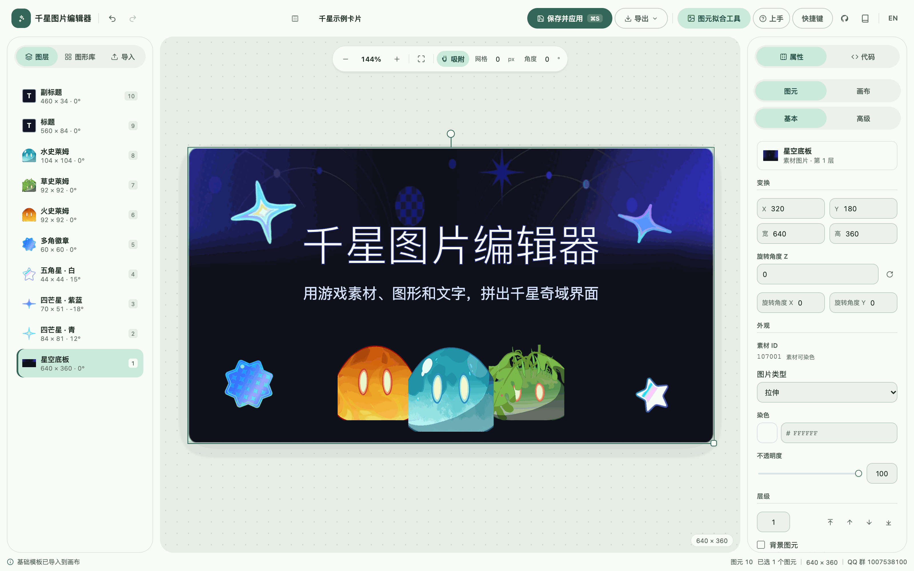

# Miliastra Image Editor

[中文](README.zh-CN.md) · **English** · [Open editor](https://qx.070077.xyz/)

A small drawing tool that runs in your browser, made for Miliastra Wonderland creators. Place the game's built-in image assets, basic shapes and editable text on one canvas, then export the result for the game editor as a GIA interface asset or a Lua drawing script.

Open the page and start; there is nothing to install. Edit by hand, or let a WebMCP-capable AI client work on the canvas for you.



## Start creating

1. Open the [editor](https://qx.070077.xyz/). Drag a shape or game asset from the **Library** onto the canvas, or double-click to add it. To continue an existing CSS, SVG, JSON or Lua file, use **Import**.
2. Drag, resize and rotate elements on the canvas. Edit text, colors, image types and masks in the **Properties** panel. Shift-click or drag on empty space to select several elements.
3. Choose **Export → JSON** to keep an editable copy. Choose **GIA** or **Lua** to use the result in the game editor.

The **Quick start** tour opens on your first visit. Reopen it any time with **Help** in the top bar.

> **The editor does not save your work automatically.** **Save & Apply** (also `Ctrl/⌘+S`) only syncs the elements on the canvas to the code preview and the library's **Saved Elements**, so you can reuse them later. It does not write a file. Export your work before you reload or close the page.

## What you can make

- **Basic shapes**: rectangles, ellipses, triangles, stars and rings.
- **Game image assets**: a built-in library with search and category filters, Basic/Stretch image types, tinting for monochrome assets, and layer ordering.
- **Editable textboxes**: rich text, font sizing, outline and alignment, exported as native textboxes in the game.
- **Comfortable editing**: multi-select, marquee selection, group moves, copy and paste, undo and redo, with shortcuts for common actions.
- **Image masks**: masks, feathering and progress fill are exported with Lua or container-node GIA. A dashed contour and shaded overlay show you what is hidden.
- **Prefabs**: look up a thumbnail by prefab ID and drag it onto the canvas for drawing with Lua.

## Pick an export format

| Format | Best for | Notes |
|---|---|---|
| JSON | Saving and continuing your work | Preserves scene settings and saved library items |
| Lua | Drawing native images and text in a client UI | Requires your control template indices and script attachment |
| GIA | Importing a UI asset group into the game editor | Scenes containing Prefabs or active element masks require Lua or container-node GIA instead |
| Container node GIA | Importing as a client control template with image children | No script needed; element masks and progress fill are included; textboxes, Prefabs and circular canvas masks are not exported |
| CSS / SVG | Sharing or using the supported artwork subset | SVG omits rings; complex SVG is not a lossless editing format |
| PNG | Rendered image via the API or AI preview tool | Unavailable for Prefabs and active element masks |

The canvas background is a viewing preference. Add a full-canvas rectangle if the exported artwork needs a solid background. Web mask previews are approximations; check the final result in the game.

## Useful shortcuts

Use `Ctrl` on Windows/Linux or `⌘` on macOS.

- Shift-click: add/remove canvas selections; Shift-click in Layers: select a range.
- Drag empty space: marquee selection. Space-drag or middle-drag: pan the view.
- `Ctrl/⌘+A`, `C`, `X`, `V`, `D`: select all, copy, cut, paste, duplicate.
- Arrow keys: move 1px; Shift+arrow: 10px. Delete removes selected elements.
- `Ctrl/⌘+Z`: undo; `Ctrl/⌘+Shift+Z` or `Ctrl/⌘+Y`: redo.
- Click **Shortcuts** or press `?` for the full list. Text fields and dialogs keep their own keys.

## Use with AI / WebMCP

If your browser or AI client supports WebMCP, you can hand the canvas over to an AI. It can search assets, look at the canvas, edit in bulk, import, export and undo. Once the editor is open, ask it to list the tools on the current page, then describe what you want, for example:

> Keep the existing artwork and make a 600×400 title card with a dark background, three image elements and a centered title. Export JSON when finished.

The AI works on the open page; this project does not provide a standalone MCP server. If the AI does not find any tools, check that the browser integration exposes `document.modelContext.registerTool`. Ordinary browsers can still use the editor manually.

[WebMCP setup and examples](docs/webmcp.md) · [Reusable AI skills](skills/)

## Run locally

Install **Python 3.13** and **Node.js 20+** (with npm), clone the repository, then run:

```powershell
# Windows PowerShell, from the repository root
.\start.bat
```

```bash
# Linux / macOS, from the repository root
bash start.sh
```

The launcher installs dependencies, builds the frontend and serves the app at **http://localhost:8439**. Docker works too, and the image build compiles the frontend for you:

```bash
docker build -t miliastra-image-editor .
docker run --rm -p 8439:8439 miliastra-image-editor
```

## More help

- [User guide and document index](docs/README.md) (Chinese)
- [Keyboard and mouse operations](docs/editor-interaction.md)
- [Lua export and masks](docs/lua-mask.md)
- [Local development and deployment](docs/deploy.md)
- [Image fitting tool](https://qx-img.070077.xyz/): turn an existing bitmap into shapes
- [Report an issue](https://github.com/1475505/Miliastra-image-editor-webui/issues)

Please follow the game's creator rules and respect others' rights. [License](LICENSE).
